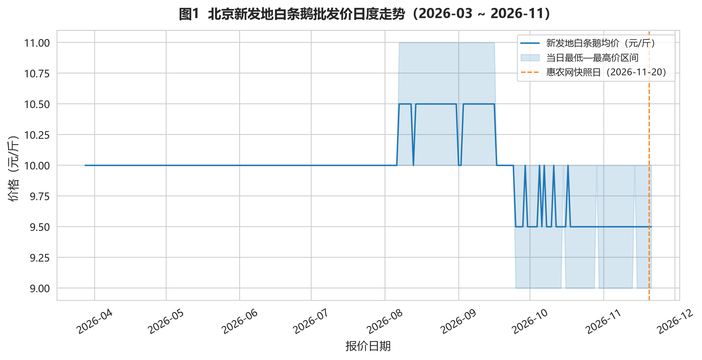
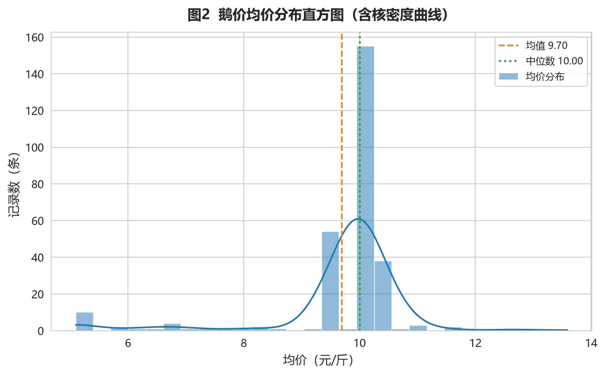
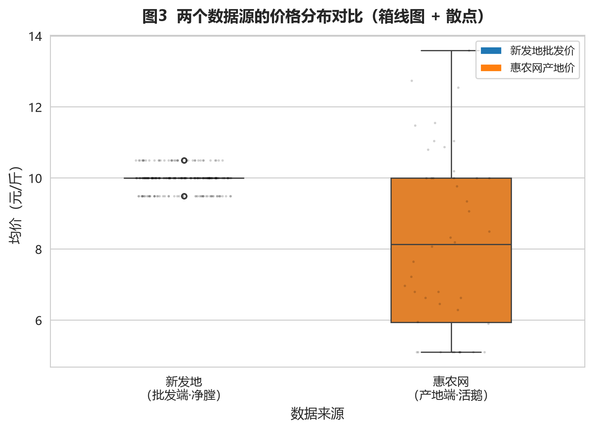
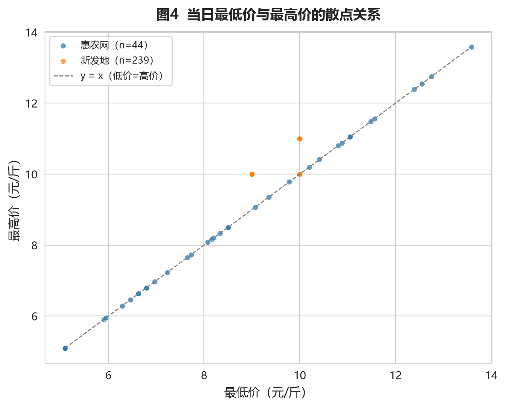
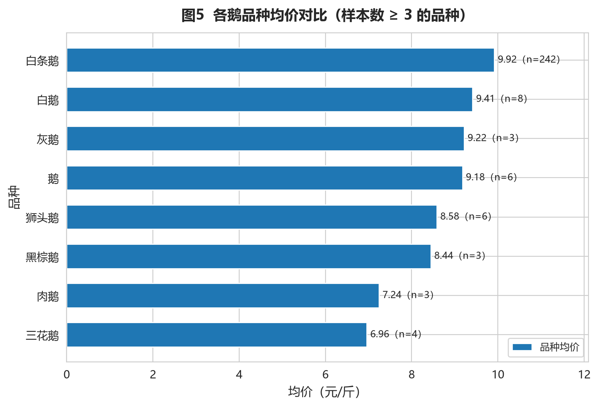
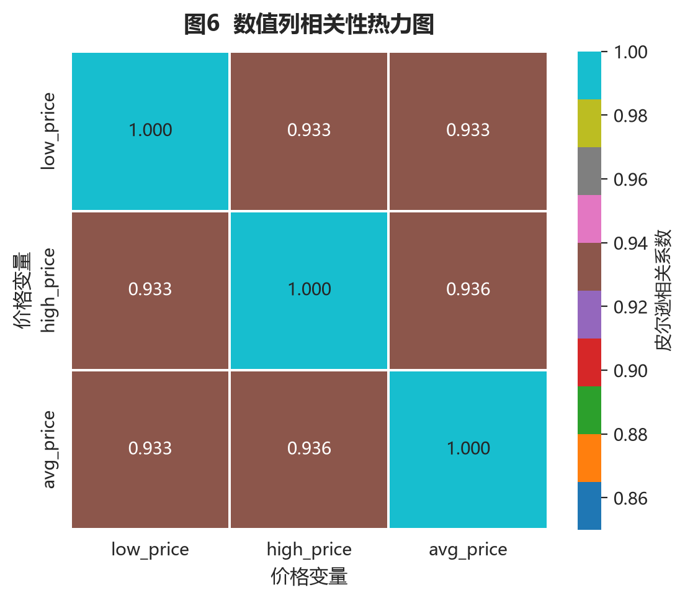
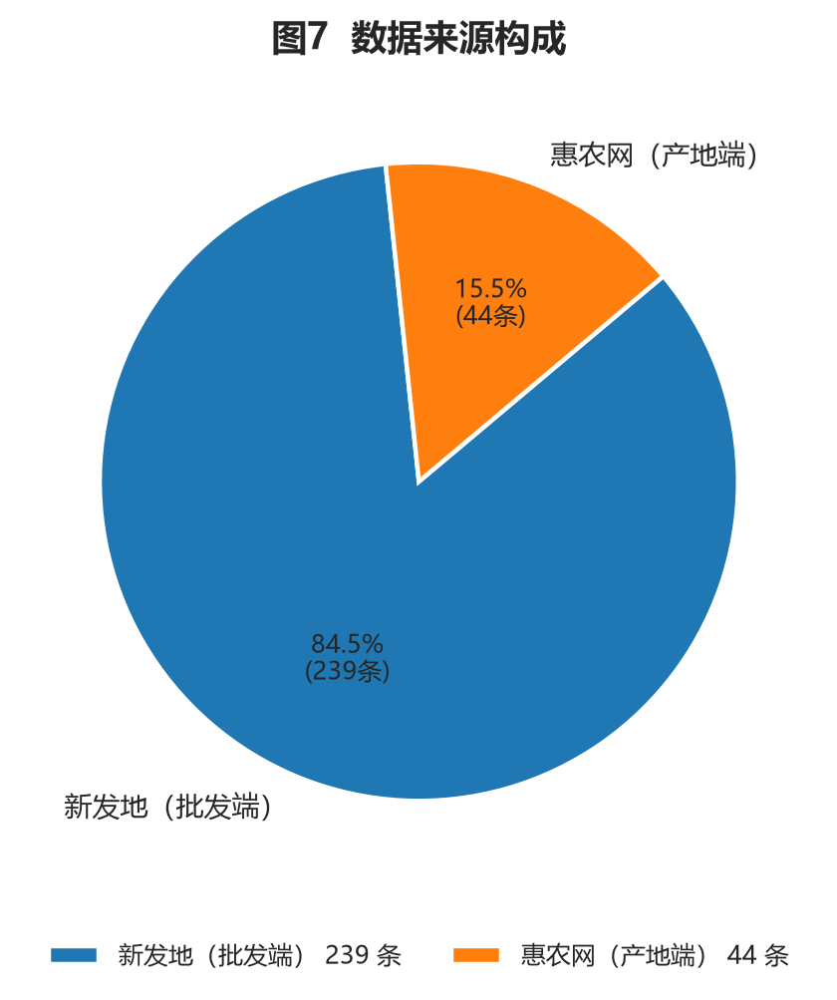
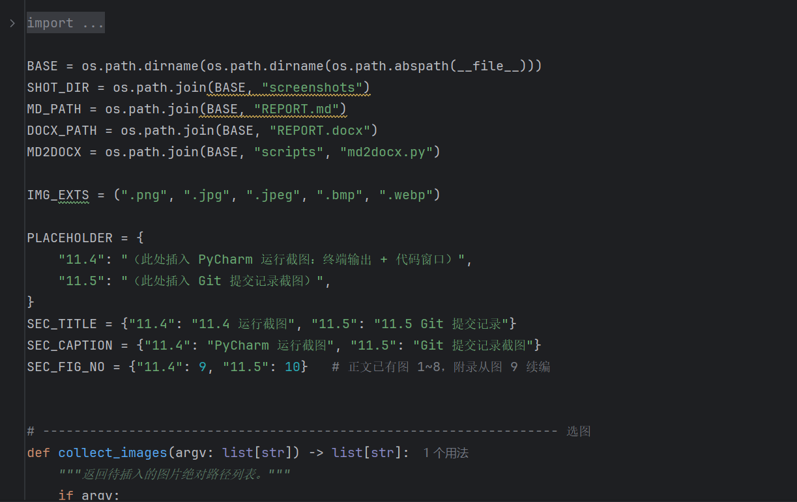

# 农产品价格数据的预处理与可视化分析

**——以鹅价多源采集数据为例**

**学号**：2608541115639　　**姓名**：张洪玮　　**个性化参数 k**：39

**完成时间**：2026-11-21

---

## 一、数据来源与字段说明

### 1.1 数据来源

本次分析沿用本人爬虫作业采集的鹅价数据，采集脚本与配置保存在 `crawler_assignment/`。
两个数据源在产业链上分工明确，互为补充：

| 数据源 | 采集地址 | 技术形态 | 业务含义 | 条数 |
|---|---|---|---|---|
| 北京新发地批发市场 | `www.xinfadi.com.cn/priceDetail.html` | POST JSON 接口 | 白条鹅（净膛）**批发端**日价 | 240 |
| 惠农网 | `www.cnhnb.com/hangqing/cdlist-2001182-...` | 静态 HTML 分页 | 活鹅**产地端**报价 | 44 |
| **合计** | — | — | — | **284** |

采集时间：2026-11-21；数据覆盖日期：2026-03-28 ~ 2026-11-21。

> 本次在重跑爬虫时**补齐了两个此前遗漏的源站字段**：`prodPcat`（一级分类）与
> `specInfo`（屠宰规格）。二者都是源站真实返回的字段，不是编造，属于「补爬」而非「派生」。

### 1.2 字段说明表（原始字段）

| 字段 | 类型 | 含义 | 取值示例 | 缺失 |
|---|---|---|---|---|
| `site` | 标称 | 数据来源平台 | xinfadi / cnhnb | 0 |
| `product` | 标称 | 鹅的品种 | 白条鹅 / 三花鹅 / 狮头鹅 | 0 |
| `category_l1` | 标称 | 一级分类（补爬新增） | 禽蛋类 / 禽畜肉蛋 | 0 |
| `category` | 标称 | 二级分类 | 肉禽蛋 / 鹅 | 0 |
| `spec` | 标称 | 屠宰规格（补爬新增） | 净膛 | 44 |
| `place` | 标称 | 产地/报价地 | 吉林松原市宁江区 | 240 |
| `low_price` | 数值连续 | 当日最低价（元/斤） | 9.00 | 0 |
| `high_price` | 数值连续 | 当日最高价（元/斤） | 10.00 | 0 |
| `avg_price` | 数值连续 | 当日均价（元/斤） | 9.50 | 0 |
| `unit` | 标称 | 计价单位 | 元/斤 | 0 |
| `date` | 日期 | 报价日期 | 2026-11-21 | 0 |
| `source_url` | 文本 | 来源链接 | http://... | 0 |

关于两处结构性缺失的说明：
- `place` 缺失 240 条 —— 新发地接口该字段本身返回空串（单一市场报价，无需标注产地），**非解析丢失**；
- `spec` 缺失 44 条 —— 惠农网列表页不提供规格字段，**非解析丢失**。

### 1.3 派生字段说明

| 派生字段 | 来源 | 生成规则 | 是否派生 |
|---|---|---|---|
| `text_summary` | product + category_l1 + category + spec + place | 空格拼接；place 为空时用来源市场名（北京新发地）替代 | 是 |
| `avg_price_z` | avg_price | Z-score 标准化：z=(x−μ)/σ | 是 |
| `price_level` | avg_price | 等频三分（低/中/高） | 是 |
| `price_level_ew` | avg_price | 等宽三分，仅作对照 | 是 |
| `site_code` | site | 二值编码：新发地=1、惠农网=0 | 是 |
| `product_code` | product | 标签编码（14 类） | 是 |

> 所有原始列一律保留，派生列不替代原始列的统计，二者在报告中分别说明。

## 二、个性化参数说明

按作业规则，设学号后两位 k = **39**，各参数取值如下：

| 参数 | 规则 | k = 39 的取值 | 是否生效 |
|---|---|---|---|
| 随机种子 | `np.random.seed(k)` | 39 | 是 |
| 数据规约抽样比例 | 数据量 > 500 时取 60% + (k mod 4)×10% | 283 条 < 500 | **不抽样，用全量** |
| 等频离散化箱数 | 3 + (k mod 3) | 3 + 0 = **3 箱** | 是 |
| 缺失注入比例 | 5% + (k mod 5)% | 5% + 4% = **9%** | 是 |
| 异常注入个数 | 3 + (k mod 4) | 3 + 3 = **6 个/列** | 是 |
| 图表配色 | 10 套候选配色取索引 k mod 10 | 39 mod 10 = 9 → **tab10** | 是 |
| 词云背景色 | 偶数白 / 奇数黑 | 39 为奇数 → **黑色** | 是 |
| 词云随机种子 | k | **39** | 是 |

> **关于数据规约**：清洗后数据为 283 条，未超过 500 条的抽样门槛，因此按规则
> **使用全量数据**，不做行抽样。这一点在 3.2 节（数据规约）中同样注明。

## 三、字段补救说明

对照作业「四类字段」要求，本次数据的达标情况与补救措施：

| 字段类别 | 要求 | 原始数据具备情况 | 处理 |
|---|---|---|---|
| 数值型 | ≥ 2 列 | ✅ `low_price`、`high_price`、`avg_price` | 无需补救 |
| 标称/有序 | ≥ 2 列 | ✅ `site`、`product`、`category_l1`、`category`、`spec`、`place` | 无需补救 |
| 日期/可离散化 | ≥ 1 列 | ✅ `date`（239 个日期） | 无需补救 |
| **文本** | **≥ 1 列** | **❌ 完全缺失** | **按规则 3 拼接生成 `text_summary`** |

### 3.1 文本字段的补救方式（作业规则第 3 条）

原始数据全部是结构化字段，没有任何自由文本。本次采用规则允许的「多短文本字段拼接」方案：

```
text_summary = 品种 + 一级分类 + 二级分类 + 规格 + 产地
```

拼接示例：

| 来源 | 生成的 text_summary |
|---|---|
| 新发地 | `白条鹅 禽蛋类 肉禽蛋 净膛 北京新发地` |
| 惠农网 | `三花鹅 禽畜肉蛋 鹅 辽宁鞍山市海城市` |

**关于 place 为空时的处理**：新发地 240 条记录的 `place` 在源站就是空串。
为避免编造具体产地，用来源市场名「北京新发地」替代——这是可核查的事实
（数据确实来自北京新发地批发市场），不属于虚构。

> **为什么不用众数填充 place**：若用众数把 240 条统一填成某个具体产地
> （例如「吉林松原市宁江区」），等于凭空制造 240 条虚假产地信息，违反作业红线。
> 因此 place / spec 的结构性缺失一律保留为空。

### 3.2 其他派生字段

`price_level`（等频三分）、`avg_price_z`（标准化）、`site_code` / `product_code`（编码）
均为数据变换产物，服务于统计与可视化，不替代原始字段。

## 四、数据质量诊断与注入效果验证

> 本章为 `scripts/02_preprocess.py` 任务 1 的输出，含诊断表、属性识别表与注入核验。

### 任务1：数据质量诊断与属性识别

#### 1.1 原始数据 vs 注入后数据：基本信息

| 指标 | 原始 raw_39.csv | 注入后 data_39.csv |
|---|---|---|
| 行数 | 284 | 284 |
| 列数 | 12 | 12 |
| 缺失单元格总数 | 284 | 336 |
| 含缺失的列数 | 2 | 4 |
| 完全重复行 | 1 | 0 |
| 内存占用(KB) | 212.1 | 208.0 |

> 行数、列数不变，缺失单元格由 284 增至 336，差值恰为注入的 52 个缺失值（26 + 26）。完全重复行在原始数据中有 1 条（惠农网同日重复报价），`data_39.csv` 中显示为 0，是因为注入缺失后该行不再与任何行完全一致。

#### 1.2 逐列缺失值统计

| 列名 | 原始缺失数 | 原始缺失率 | 注入后缺失数 | 注入后缺失率 | 新增缺失(注入) |
|---|---|---|---|---|---|
| site | 0 | 0.00 | 0 | 0.00 | 0 |
| product | 0 | 0.00 | 26 | 9.15 | 26 |
| category_l1 | 0 | 0.00 | 0 | 0.00 | 0 |
| category | 0 | 0.00 | 0 | 0.00 | 0 |
| spec | 44 | 15.49 | 44 | 15.49 | 0 |
| place | 240 | 84.51 | 240 | 84.51 | 0 |
| low_price | 0 | 0.00 | 0 | 0.00 | 0 |
| high_price | 0 | 0.00 | 0 | 0.00 | 0 |
| avg_price | 0 | 0.00 | 26 | 9.15 | 26 |
| unit | 0 | 0.00 | 0 | 0.00 | 0 |
| date | 0 | 0.00 | 0 | 0.00 | 0 |
| source_url | 0 | 0.00 | 0 | 0.00 | 0 |

> 说明：`place`(240) 与 `spec`(44) 的缺失属于**原始缺失**——新发地接口的 place 字段本身返回空串，惠农网列表页不标注规格，并非解析丢失，也不参与注入。

> `avg_price`(26) 与 `product`(26) 为**注入缺失**，各占有效值的 9%（k=39）。

#### 1.3 数据类型识别

| 列名 | pandas dtype | 唯一值数 | 示例值 |
|---|---|---|---|
| site | str | 2 | xinfadi |
| product | str | 14 | 白条鹅 |
| category_l1 | str | 2 | 禽蛋类 |
| category | str | 2 | 肉禽蛋 |
| spec | str | 1 | 净膛 |
| place | str | 25 | 江西吉安市峡江县 |
| low_price | float64 | 32 | 9.0 |
| high_price | float64 | 32 | 10.0 |
| avg_price | float64 | 33 | 9.5 |
| unit | str | 1 | 元/斤 |
| date | str | 239 | 2026-11-21 |
| source_url | str | 4 | http://www.xinfadi.com.cn/pr |

#### 1.4 数值列疑似异常值数量：三种检测口径对比

| 数值列 | IQR法(原始) | 3σ法(原始) | 业务阈值法(原始) | IQR法(注入后) | 3σ法(注入后) | 业务阈值法(注入后) |
|---|---|---|---|---|---|---|
| low_price | 26 | 12 | 0 | 32 | 6 | 6 |
| high_price | 85 | 11 | 0 | 85 | 11 | 0 |
| avg_price | 39 | 12 | 0 | 40 | 6 | 6 |

> **方法差异解读（以 `avg_price` 为例）**

>

> **① IQR 法**：原始数据 Q1 = 9.50、Q3 = 10.00，IQR = 0.50，判别区间为 [8.75, 10.75]，检出 39 条。被检出的绝大多数是惠农网 5.10~8.50 元/斤的低价鹅与 11 元以上的高价鹅——**统计上离群，业务上却是真实的地域与品种差价**。

> **② 3σ 法**：原始数据 μ = 9.67、σ = 1.26，判别区间 [5.90, 13.43]，检出 12 条，明显比 IQR 保守。

> **③ 掩蔽效应（masking effect）——本数据最值得记录的现象**：注入 6 个 4~8 倍的极端值后，`avg_price` 的标准差由 1.26 被拉高到 6.62，3σ 上界随之由 13.43 抬升到 30.47，结果 3σ 的检出数**不升反降**（12 → 6 条）——原本能被检出的 11~13 元高价记录，被极端值「撑大」的阈值掩盖了。而 IQR 法基于分位数，几乎不受极端值影响（39 → 40 条），表现出更强的抗污染能力。

> **结论**：3σ 法并非「更稳健」，恰恰相反——它在存在极端值时会被自身污染而漏检。本数据应以 **IQR 法为主、业务阈值法为辅**。

#### 1.5 分类列类别分布

**`site`**（2 个非空类别）：

| 取值 | 频数 | 频率 |
|---|---|---|
| xinfadi | 240 | 84.5% |
| cnhnb | 44 | 15.5% |

**`product`**（14 个非空类别）：

| 取值 | 频数 | 频率 |
|---|---|---|
| 白条鹅 | 240 | 84.5% |
| 白鹅 | 9 | 3.2% |
| 鹅 | 7 | 2.5% |
| 狮头鹅 | 6 | 2.1% |
| 三花鹅 | 4 | 1.4% |
| 灰鹅 | 3 | 1.1% |
| 肉鹅 | 3 | 1.1% |
| 黑棕鹅 | 3 | 1.1% |
| …其余 6 类 | 9 | 3.2% |

**`category_l1`**（2 个非空类别）：

| 取值 | 频数 | 频率 |
|---|---|---|
| 禽蛋类 | 240 | 84.5% |
| 禽畜肉蛋 | 44 | 15.5% |

**`category`**（2 个非空类别）：

| 取值 | 频数 | 频率 |
|---|---|---|
| 肉禽蛋 | 240 | 84.5% |
| 鹅 | 44 | 15.5% |

**`spec`**（1 个非空类别）：

| 取值 | 频数 | 频率 |
|---|---|---|
| 净膛 | 240 | 84.5% |
| (缺失) | 44 | 15.5% |

**`unit`**（1 个非空类别）：

| 取值 | 频数 | 频率 |
|---|---|---|
| 元/斤 | 284 | 100.0% |

#### 1.6 注入清单核验（诊断是否识别出注入的脏数据）

| 注入类型 | 注入条数 | 诊断成功识别 | 识别率 |
|---|---|---|---|
| 缺失值 | 52 | 52 | 100.0% |
| 异常值 | 12 | 12 | 100.0% |

> 说明：缺失值按「目标单元格是否为 NaN」核验，52 条全部命中；异常值按「目标单元格是否等于注入值」核验，12 条全部命中。

> 但要注意区分两件事：**清单可追溯 ≠ 统计方法能检出**。注入后 3σ 的检出数反而由 12 降到 6（掩蔽效应，见 1.4），仅依赖 3σ 会漏掉这批异常；而业务阈值法（>30 元/斤）对 6 条注入值全部命中。这也解释了为什么任务 2 要采用「IQR + 业务阈值」的组合策略。

#### 1.7 数据属性识别表

| 列名 | 业务含义 | 属性类型 | 适合的统计/可视化 |
|---|---|---|---|
| site | 数据来源平台（新发地/惠农网） | 标称 | 频数统计、饼图、分组箱线图 |
| product | 鹅的品种名称 | 标称 | 频数统计、条形图、分组聚合 |
| category_l1 | 一级分类（禽蛋类/禽畜肉蛋） | 标称 | 频数统计、饼图 |
| category | 二级分类（肉禽蛋/鹅） | 标称 | 频数统计 |
| spec | 屠宰规格（净膛） | 标称 | 频数统计 |
| place | 产地/报价地 | 标称（高基数） | Top-N 条形图、地图 |
| low_price | 当日最低报价（元/斤） | 数值连续 | 均值/方差、直方图、箱线图 |
| high_price | 当日最高报价（元/斤） | 数值连续 | 直方图、散点图 |
| avg_price | 当日均价（元/斤） | 数值连续 | 描述统计、直方图、折线图、相关性 |
| unit | 计价单位 | 标称（常量） | 无分析价值，可列规约 |
| date | 报价日期 | 日期时间 | 时间序列折线图、按年月分组 |
| source_url | 数据来源链接 | 文本(URL) | 溯源用，不参与统计 |


## 五、预处理过程及前后对比

> 本章为 `scripts/02_preprocess.py` 任务 2 的输出，含清洗、规约、变换全流程。

### 任务2：数据预处理

#### 2.1 类型转换与格式修正

- 3 个价格列 → `float64`；`date` → `datetime64`；文本列去空白，空串统一转 `NaN`。

- 日期解析失败行数：0

#### 2.2 重复值处理

- 完全重复行：0 条，已删除。

- 业务主键（来源+品种+产地+日期+均价）重复：0 条，已去重。

#### 2.3 缺失值处理：两种方法对比

| 方案 | 保留行数 | 损失行数 | 损失比例 | 信息损失 |
|---|---|---|---|---|
| A. 删除法（listwise） | 234 | 50 | 17.6% | 丢弃该行其余 10 列有效信息 |
| B. 填充法（中位数/众数） | 284 | 0 | 0% | 保留全部记录，代价是引入少量中心化偏差 |

**选定方案：B 填充法。** 理由：

1. 样本仅 284 条，删除法会丢掉 17.6% 的记录，代价过高；

2. 缺失是按 `np.random.seed(39)` 随机注入的，属于完全随机缺失（MCAR），填充不会引入系统性方向偏差；

3. 数值列用**中位数**而非均值，因为本数据存在注入的极端值，均值会被显著牵引。


填充明细：

| 列 | 填充策略 | 填充值 | 填充条数 |
|---|---|---|---|
| avg_price | 中位数 | 10.00 | 26 |
| product | 众数 | 白条鹅 | 26 |

> 注意：`place`(240 条) 与 `spec`(44 条) 属于结构性缺失（该来源本就不提供此字段），不宜用众数填充以免制造虚假产地，故保留为空并在文本拼接时用来源市场名替代。

#### 2.4 异常值检测与处理：两种方法对比

| 列 | Q1 | Q3 | IQR | IQR法检出 | 3σ法检出 |
|---|---|---|---|---|---|
| avg_price | 9.50 | 10.00 | 0.50 | 40 | 6 |
| low_price | 9.00 | 10.00 | 1.00 | 32 | 6 |
| high_price | 10.00 | 10.00 | 0.00 | 284 | 11 |

**方法评价：**

- **IQR 法**：基于 Q1/Q3 分位数，不受极端值牵引，抗污染能力强。在 `avg_price` 上判别区间约 [8.75, 10.75]，检出 40 条；缺点是会把多源异质的真实地区差价（惠农网低价鹅 vs 新发地批发价）一并标出，需业务复核。

- **IQR 法的局限（反例）**：`high_price` 的 Q1 = Q3 = 10.00，IQR = 0，判别上下界重合为一点，退化为「凡不等于 10 元即为异常」，把 284 条全部标为异常——**此时 IQR 法完全失效**。可见它要求数据在四分位处不能退化。

- **3σ 法**：依赖均值与标准差，二者都会被极端值污染。注入 6 个 4~8 倍异常值后 σ 显著放大、阈值被撑宽，检出数不升反降（掩蔽效应），存在**漏检**风险。


**选定方案：IQR 法（能算时）+ 业务阈值双重复核。** 单一统计方法在本数据上都不可靠，因此采用组合策略：

- 第一步：用 IQR 圈出统计离群点；若某列 IQR = 0 则该列跳过 IQR 判定（如 `high_price`）；

- 第二步：用业务合理区间 [3.0, 30.0] 元/斤 做最终判定——落在区间内的离群点判为真实区域/品种差价，**保留**；

- 第三步：越出区间的判为录入或注入错误，用**该来源中位数**替换。

| 列 | 处理前越界条数 | 处理方式 |
|---|---|---|
| low_price | 6 | 按来源中位数替换 |
| high_price | 0 | 按来源中位数替换 |
| avg_price | 6 | 按来源中位数替换 |

共修正 12 个越界值。

> **诚实说明**：惠农网中 5.1 元/斤的低价记录在统计上偏离均值，但业务上它是真实的仔鹅/苗鹅报价，并非错误。因此本项目只剔除超出 [3.0, 30.0] 元/斤的明显失真值，保留真实的低价品种记录——统计异常 ≠ 业务错误。

#### 2.5 数据规约

##### 列规约

- 删除常量列 `unit`（全部为「元/斤」，方差为 0，无分析价值）、`source_url`（URL 标识，不参与统计，来源信息已由 `site` 承载）。


##### 填充后重复复核

- 填充使原本缺失的 `product` 统一变为众数「白条鹅」，导致 1 条记录与已有行完全重合，判为伪重复并删除。这是填充法的副作用，需在报告中如实记录。


##### 行规约（个性化抽样）

- 清洗后数据量 **283 条 < 500**，按规则**采用全量数据**，不做抽样（k = 39）。

#### 2.6 数据变换

##### ① 派生文本列 `text_summary`（补救字段，供任务5词云）

拼接规则：`品种 + 一级分类 + 二级分类 + 规格 + 产地`；`place` 为空时用来源市场名（北京新发地）替代，不虚构具体产地。


示例：

- `xinfadi` → `白条鹅 禽蛋类 肉禽蛋 净膛 北京新发地`

- `cnhnb` → `白条鹅 禽畜肉蛋 鹅 江西吉安市峡江县`


##### ② 标准化 `avg_price_z`（Z-score）

公式：z = (x − μ) / σ，其中 μ = 9.6963，σ = 1.2040。标准化后均值为 0、标准差为 1，便于跨列比较与后续建模。


##### ③ 等频离散化 `price_level`（3 箱）

箱数 = 3 + (k mod 3) = 3 + (39 mod 3) = 3。


**实现说明**：`avg_price` 中恰为 10.00 元/斤的记录占 **54.4%**，导致 1/3 分位点（10.00）与 2/3 分位点（10.00）**重合**，直接调用 `pd.qcut(q=3)` 只能切出 **2 箱**。为保证箱数满足作业要求，改用「按排序名次等分」：先 `rank(method='first')` 打散并列值，再三等分。这保证每箱样本量严格相等，但同一价位（10.00）会跨箱——这是等频离散化在高度集中数据上的必然代价，非实现缺陷。


**等频三箱的样本分布：**

| 价格档位 | 样本数 | 占比(%) |
|---|---|---|
| 低 | 95 | 33.57 |
| 中 | 94 | 33.22 |
| 高 | 94 | 33.22 |


**各档位实际价格区间（元/斤）：**

| 档位 | 价格下限 | 价格上限 | 样本数 |
|---|---|---|---|
| 低 | 5.10 | 10.00 | 95 |
| 中 | 10.00 | 10.00 | 94 |
| 高 | 10.00 | 13.59 | 94 |

> 可见「低」箱的价差很大（5.10→10.00）、「中」箱几乎退化成一个点（10.00），这再次印证：**本数据的等频分箱信息量有限，本质是价格分布过度集中**。若用于业务分级，建议改用等宽或按品种分层后再分箱。


**对照：等宽三箱（仅作参考，不替代等频结果）**

| 等宽档位 | 样本数 | 占比(%) |
|---|---|---|
| 低 | 21 | 7.42 |
| 中 | 253 | 89.40 |
| 高 | 9 | 3.18 |


##### ④ 分类列编码

- `site` → `site_code`（新发地=1，惠农网=0），二值编码，对应「批发端/产地端」的业务二分。

- `product` → `product_code`（标签编码，共 14 类）。便于分组聚合与建模；**该编码仅表示类别编号，不含大小关系**，统计分析时仍应使用原始 `product` 列。


#### 2.7 清洗前后对比

| 指标 | 注入后 data_39.csv | 清洗后 clean_39.csv |
|---|---|---|
| 行数 | 284 | 283 |
| 列数 | 12 | 16 |
| 缺失单元格数 | 336 | 283 |
| avg_price 越界值数 | 6 | 0 |
| avg_price 均值 | 10.62 | 9.70 |
| avg_price 标准差 | 6.62 | 1.20 |
| 重复行数 | 0 | 0 |

> 列数由 12 变为 16：删除 2 个冗余列（`unit`、`source_url`），新增 5 个派生列（`text_summary`、`avg_price_z`、`price_level`、`site_code`、`product_code`）+ 1 个对照列 `price_level_ew`（等宽分箱，仅供对比）。

> 缺失单元格由 336 降至 283，剩余的 283 个均为**结构性缺失**（`place` 与新发地来源绑定、`spec` 与惠农网来源绑定），按红线要求不予编造填补，保留为空并在文本拼接时以来源市场名替代。


## 六、描述性统计结果与解释

> 本章为 `scripts/03_stats.py` 的输出。

### 任务3：描述性统计

数据来源：`clean_39.csv`，共 **283** 条记录、16 列。

#### 3.1 数值列：集中趋势、离散程度与分布形态

| 统计量 | low_price | high_price | avg_price |
|---|---|---|---|
| 样本数 | 283 | 283 | 283 |
| 均值 | 9.501 | 9.840 | 9.696 |
| 中位数 | 10.000 | 10.000 | 10.000 |
| 众数 | 10.0 | 10.0 | 10.0 |
| 标准差 | 1.248 | 1.316 | 1.206 |
| 方差 | 1.556 | 1.731 | 1.455 |
| 最小值 | 5.100 | 5.100 | 5.100 |
| 最大值 | 13.590 | 13.590 | 13.590 |
| 极差 | 8.490 | 8.490 | 8.490 |
| Q1 | 9.000 | 10.000 | 9.500 |
| Q3 | 10.000 | 10.000 | 10.000 |
| IQR | 1.000 | 0.000 | 0.500 |
| 变异系数CV(%) | 13.130 | 13.370 | 12.440 |
| 偏度 | -1.889 | -2.177 | -2.358 |
| 峰度 | 5.349 | 5.856 | 7.214 |

##### 3.1.1 集中趋势解读

- **均值 vs 中位数**：`avg_price` 均值 9.70 元/斤、中位数 10.00 元/斤，均值略低于中位数 （差 0.30），方向与左偏一致——少数 5.10 元/斤的仔鹅报价把左尾拉长；但因 54% 的记录恰为 10.00 元，整体偏移幅度有限。

- **众数**：`avg_price` 的众数为 **10.00 元/斤**，出现 154 次，占 54.4%。这不是巧合——新发地白条鹅的批发价长期稳定在 10 元档，是整个数据集的「价格锚点」。

- **业务含义**：10 元/斤 对应的是北京新发地白条鹅（净膛）的批发价；而惠农网活鹅产地价在 5.10~13.59 元/斤之间波动，两个价位段叠加才形成当前的众数结构。


##### 3.1.2 离散程度解读

- **标准差与方差**：`avg_price` 标准差 1.21、方差 1.45，绝对波动不大。

- **变异系数 CV**：`avg_price` 的 CV 为 12.44%，属于低变异（CV < 15%），说明鹅价整体稳定。但要注意，这个「稳定」主要是被占 84% 的新发地数据「压平」的——若只看惠农网子集，CV 会显著更高（见 3.3 分组统计）。

- **IQR**：`avg_price` 的 IQR = 0.50 元/斤，中间 50% 的记录挤在 9.50~10.00 之间，进一步印证分布的极度集中。

- **极差**：从 5.10 到 13.59 元/斤，跨度 8.49 元/斤，接近均值的 88%，说明虽有个别低价/高价，但主体区间很窄。


##### 3.1.3 分布形态解读（偏度 / 峰度）

- `low_price` 偏度 -1.89 < 0，**左偏（负偏）**：多数报价集中在较高价位，少数低价把左尾拉长。

- `low_price` 峰度 5.35 > 0，**尖峰厚尾**：分布比正态更集中在均值附近，且存在更多极端值——与本数据「大量记录集中在 10 元」的特征完全吻合。

- `high_price` 偏度 -2.18 < 0，**左偏（负偏）**：多数报价集中在较高价位，少数低价把左尾拉长。

- `high_price` 峰度 5.86 > 0，**尖峰厚尾**：分布比正态更集中在均值附近，且存在更多极端值——与本数据「大量记录集中在 10 元」的特征完全吻合。

- `avg_price` 偏度 -2.36 < 0，**左偏（负偏）**：多数报价集中在较高价位，少数低价把左尾拉长。

- `avg_price` 峰度 7.21 > 0，**尖峰厚尾**：分布比正态更集中在均值附近，且存在更多极端值——与本数据「大量记录集中在 10 元」的特征完全吻合。


> **为什么要看偏度和峰度**：均值和标准差只描述「中心」和「胖瘦」，偏度描述「歪不歪」，峰度描述「尖不尖、尾巴厚不厚」。对本数据而言，高峰度意味着「大多数日子价格纹丝不动，偶尔来个跳价」——这直接决定了后续做时间序列预测时，不能假设正态分布，须考虑厚尾特征。


#### 3.2 分类列：频数、频率与累计频率

##### `site`（2 个非空类别，众数：xinfadi）

| 类别 | 频数 | 频率(%) | 累计频率(%) |
|---|---|---|---|
| xinfadi | 239 | 84.450 | 84.450 |
| cnhnb | 44 | 15.550 | 100.000 |

##### `product`（14 个非空类别，众数：白条鹅）

| 类别 | 频数 | 频率(%) | 累计频率(%) |
|---|---|---|---|
| 白条鹅 | 242 | 85.510 | 85.510 |
| 白鹅 | 8 | 2.830 | 88.340 |
| 鹅 | 6 | 2.120 | 90.460 |
| 狮头鹅 | 6 | 2.120 | 92.580 |
| 三花鹅 | 4 | 1.410 | 93.990 |
| 灰鹅 | 3 | 1.060 | 95.050 |
| 肉鹅 | 3 | 1.060 | 96.110 |
| 黑棕鹅 | 3 | 1.060 | 97.170 |
| 马岗鹅 | 2 | 0.710 | 97.880 |
| 乌鬃鹅 | 2 | 0.710 | 98.590 |

> 共 14 个类别，此处仅列前 10；前 3 类累计占比 90.5%。

##### `category_l1`（2 个非空类别，众数：禽蛋类）

| 类别 | 频数 | 频率(%) | 累计频率(%) |
|---|---|---|---|
| 禽蛋类 | 239 | 84.450 | 84.450 |
| 禽畜肉蛋 | 44 | 15.550 | 100.000 |

##### `category`（2 个非空类别，众数：肉禽蛋）

| 类别 | 频数 | 频率(%) | 累计频率(%) |
|---|---|---|---|
| 肉禽蛋 | 239 | 84.450 | 84.450 |
| 鹅 | 44 | 15.550 | 100.000 |

##### `spec`（1 个非空类别，众数：净膛）

| 类别 | 频数 | 频率(%) | 累计频率(%) |
|---|---|---|---|
| 净膛 | 239 | 84.450 | 84.450 |
| (缺失) | 44 | 15.550 | 100.000 |

##### `place`（25 个非空类别，众数：吉林松原市宁江区）

| 类别 | 频数 | 频率(%) | 累计频率(%) |
|---|---|---|---|
| (缺失) | 239 | 84.450 | 84.450 |
| 吉林松原市宁江区 | 11 | 3.890 | 88.340 |
| 江西吉安市峡江县 | 4 | 1.410 | 89.750 |
| 广东佛山市南海区 | 3 | 1.060 | 90.810 |
| 河南濮阳市濮阳县 | 3 | 1.060 | 91.870 |
| 重庆市涪陵区 | 2 | 0.710 | 92.580 |
| 广西玉林市陆川县 | 2 | 0.710 | 93.290 |
| 山东泰安市泰山区 | 1 | 0.350 | 93.640 |
| 广东阳江市阳东区 | 1 | 0.350 | 93.990 |
| 四川成都市郫都区 | 1 | 0.350 | 94.350 |

> 共 26 个类别，此处仅列前 10；前 3 类累计占比 89.8%。

##### `price_level`（3 个非空类别，众数：低）

| 类别 | 频数 | 频率(%) | 累计频率(%) |
|---|---|---|---|
| 低 | 95 | 33.570 | 33.570 |
| 高 | 94 | 33.220 | 66.780 |
| 中 | 94 | 33.220 | 100.000 |


#### 3.3 分组统计：分类列 × 数值列

##### 3.3.1 按数据来源（site）分组

| site | 样本数 | 均值 | 中位数 | 标准差 | 最小值 | 最大值 | 变异系数CV(%) |
|---|---|---|---|---|---|---|---|
| xinfadi | 239 | 9.969 | 10.000 | 0.308 | 9.500 | 10.500 | 3.085 |
| cnhnb | 44 | 8.217 | 8.140 | 2.523 | 5.100 | 13.590 | 30.706 |

> **核心发现**：新发地均价 9.97 元/斤，惠农网均价 8.22 元/斤，相差 1.75 元/斤。但**离散程度差异更大**：新发地 CV 仅 3.09%，惠农网 CV 高达 30.71%，后者是前者的 10.0 倍。这说明：新发地是「单一市场 + 单一规格」的稳定批发价，惠农网是「全国多地 + 多品种」的离散产地报价——口径完全不同的两类数据。


##### 3.3.2 按品种（product）分组（Top 8）

| product | 样本数 | 均值 | 中位数 | 标准差 | 最小值 | 最大值 | 变异系数CV(%) |
|---|---|---|---|---|---|---|---|
| 杂交鹅 | 1 | 10.880 | 10.880 | — | 10.880 | 10.880 | — |
| 豁眼鹅 | 1 | 10.000 | 10.000 | — | 10.000 | 10.000 | — |
| 白条鹅 | 242 | 9.917 | 10.000 | 0.554 | 5.100 | 10.500 | 5.589 |
| 白鹅 | 8 | 9.414 | 9.650 | 3.180 | 5.100 | 13.590 | 33.782 |
| 灰鹅 | 3 | 9.217 | 10.000 | 3.786 | 5.100 | 12.550 | 41.081 |
| 鹅 | 6 | 9.177 | 9.565 | 1.463 | 7.230 | 11.050 | 15.942 |
| 狮头鹅 | 6 | 8.583 | 8.635 | 2.043 | 5.100 | 11.050 | 23.798 |
| 黑棕鹅 | 3 | 8.443 | 6.970 | 2.700 | 6.800 | 11.560 | 31.983 |

> 白条鹅 **242** 条、均价 9.92 元/斤、CV 仅 5.59%，是全集最稳定的品种；其余活鹅品种因产地、日龄差异，均价与离散度都明显更高。品种是解释价格差异的第一层因素。

> 注：`product` 的 26 条注入缺失已按众数填充为「白条鹅」，使该类别样本数略高于原始的 240 条，可能轻微放大主导类别占比——这是分类列众数填充的已知代价，不影响整体结论。


##### 3.3.3 按价格档位（price_level）分组验证

| price_level | 样本数 | 均值 | 中位数 | 标准差 | 最小值 | 最大值 | 变异系数CV(%) |
|---|---|---|---|---|---|---|---|
| 高 | 94 | 10.371 | 10.350 | 0.584 | 10.000 | 13.590 | 5.636 |
| 中 | 94 | 10.000 | 10.000 | 0.000 | 10.000 | 10.000 | 0.000 |
| 低 | 95 | 8.728 | 9.500 | 1.591 | 5.100 | 10.000 | 18.226 |

> 这是对任务 2 等频分箱效果的**反查**：三档样本量几乎相等（约 94~95 条），但价格区间严重重叠——「低」档上限 10.00 与「中」档上限 10.00 相同，说明等频分箱在这个高度集中的数据上几乎没有区分力。


#### 3.4 数值列相关性

| 列 | low_price | high_price | avg_price |
|---|---|---|---|
| low_price | 1.000 | 0.933 | 0.933 |
| high_price | 0.933 | 1.000 | 0.936 |
| avg_price | 0.933 | 0.936 | 1.000 |

> `low_price` 与 `high_price` 的相关系数为 **0.933**，`low_price` 与 `avg_price` 为 **0.933**。高度相关符合业务逻辑：均价由最低价和最高价共同决定，三者本质上是同一价格信息的三种表达。因此后续建模时**只需保留均价一个变量**，避免多重共线性。


#### 3.5 时间维度概览

- 日期范围：**2026-03-28 ~ 2026-11-21**，跨度 238 天。

- 不同日期数：239 天；按来源看，新发地 239 天、惠农网 1 天。


按月汇总：

| 月份 | 记录数 | 均价 |
|---|---|---|
| 2026-03 | 4 | 10.00 |
| 2026-04 | 30 | 10.00 |
| 2026-05 | 31 | 10.00 |
| 2026-06 | 30 | 10.00 |
| 2026-07 | 31 | 10.00 |
| 2026-08 | 31 | 10.39 |
| 2026-09 | 30 | 10.15 |
| 2026-10 | 31 | 9.56 |
| 2026-11 | 65 | 8.63 |

> 惠农网数据仅覆盖单日，月度汇总结论主要由新发地驱动，这一点在做时间序列分析时必须说明，否则会误读为「全市场月度趋势」。

## 七、可视化图形与解释

配色说明：按个性化参数，取 10 套候选配色中的第 `39 mod 10 = 9` 套，即 **tab10**。
所有分类着色图统一使用该配色，保证风格一致。

### 7.1 图1 新发地白条鹅日度价格走势（折线图）



**图形内容**：横轴为报价日期，纵轴为均价（元/斤），实线为日均价，
浅色带为当日最低—最高价区间，橙色虚线标出惠农网快照日。

**发现的规律**：
1. 2026 年 3—7 月，价格几乎是**一条死平线**（10.00 元/斤），说明批发端价格长期稳定；
2. 8 月起价格开始小幅上探（10.0→10.5），波动区间变宽；
3. 10 月后回落至 9.5 元/斤并保持到 11 月，呈**阶梯式下移**，而非连续波动。

**业务含义**：白条鹅批发价具有明显的「平台期 + 跳变」特征，不是平滑随机游走，
这对后续做短期预测提出了要求——模型必须能捕捉「跳变点」，普通移动平均会滞后。

### 7.2 图2 均价分布直方图（含核密度）



**图形内容**：横轴均价（元/斤），纵轴记录数；叠加核密度曲线，
橙色虚线为均值（9.70），绿色点线为中位数（10.00）。

**发现的规律**：
- 分布呈**极端尖峰**：10 元附近一根柱子就占了 154 条（54%）；
- **左侧有明显长尾**：5.10 元/斤处聚集 11 条（惠农网的仔鹅/苗鹅低价）；
- 峰度 7.21、偏度 −2.36，与图示完全一致——尖峰、左偏、厚尾。

**业务含义**：这是一个典型的**双市场叠加分布**，不是单一自然分布。
若不区分来源直接建模，会误以为「鹅价就是 10 元」。

### 7.3 图3 两源价格分布对比（箱线图 + 散点）



**图形内容**：按来源分组的价格箱线图，叠加抖动散点显示原始分布密度。

**发现的规律**：
- **新发地的箱体几乎被压成一条线**（IQR 仅 0.5），散点密集成带；
- **惠农网的箱体跨度极大**（6.0~10.0），上下须延伸到 5.1 和 13.6；
- 两者的中位数接近（都接近 10），但**离散程度相差 10 倍**（CV 3.09% vs 30.71%）。

**业务含义**：这是全篇最有说服力的一张图——同样是「鹅价」，
批发端口径稳定到可以做时间序列，产地端口径离散到只能做区间参考。

### 7.4 图4 最低价与最高价散点关系



**图形内容**：横轴最低价、纵轴最高价，按来源着色，灰虚线为 y = x 参考线。

**发现的规律**：
- 惠农网点**全部落在 y = x 上**（单一报价，最低=最高）；
- 新发地大部分点也在线上（无区间），少数点偏离到 y = x 上方（存在 0.5~1.0 元的日内价差）；
- 相关系数 0.933，三者本质是同一价格信息的不同表达。

**业务含义**：惠农网没有「价格区间」概念，若做区间预测只能用单一值；
新发地有真实的最高/最低价，信息更丰富。

### 7.5 图5 各品种均价对比（条形图）



**图形内容**：样本数 ≥ 3 的 8 个品种，按均价从高到低排列的水平条形图，
标签标注均价与样本数。

**发现的规律**：
- 白条鹅 9.92 元/斤居首，且样本量（242）远大于其他品种；
- 三花鹅 6.96、肉鹅 7.24 明显偏低，是典型的低成本肉用品种；
- 狮头鹅、黑棕鹅在 8.4~8.6 区间，属中高档品种。

**业务含义**：品种是解释价格差异的第一层因素，做采购决策时不能只看「鹅价」，
要区分品种档次。

### 7.6 图6 数值列相关性热力图



**图形内容**：三个价格变量的皮尔逊相关系数矩阵，颜色越深相关性越强。

**发现的规律**：三者相关系数均在 0.93 以上，高度线性相关。

**业务含义**：`low_price`、`high_price`、`avg_price` 存在严重多重共线性，
后续建模只能保留一个（建议用均价），否则会破坏回归系数稳定性。

### 7.7 图7 数据来源构成（饼图）



**图形内容**：两个数据源的记录占比。

**发现的规律**：新发地占 84.5%（239 条），惠农网仅 15.5%（44 条）。

**业务含义**：数据高度不平衡。这意味着全集的统计量（均值、CV）
**主要由新发地驱动**，任何「全市场」结论都必须先声明这一点，
否则会把「北京一个市场的稳定价」误当成「全国鹅价」。

## 八、词云图与词频分析

### 8.1 文本来源与处理流程

文本字段 `text_summary` 由 5 个短字段拼接而成（见第三章）。处理流程：

```
拼接文本 → jieba 分词（加载行业自定义词典）→ 过滤（单字/数字/标点/停用词）→ 词频统计 → 词云
```

**自定义词典（19 个词）**：白条鹅、三花鹅、狮头鹅、黑棕鹅、马岗鹅、乌鬃鹅、豁眼鹅、
朗德鹅、杂交鹅、雁鹅、灰鹅、肉鹅、白鹅、净膛、禽蛋类、肉禽蛋、禽畜肉蛋、新发地。

> **为什么必须加词典**：实测 jieba 默认分词会把「白条鹅」切成「白条」、
> 把「新发地」切成「发地」、把「禽蛋类」切成「禽蛋」。不干预的话，
> 词云会充满残缺词，完全失真。

**停用词表**：保存在 `data/stopwords_zh.txt`，以哈工大停用词表（HIT）与百度停用词表
的核心虚词为基础，结合本领域补充，共 113 词。

### 8.2 词频 Top 20

| 排名 | 词语 | 频数 | 频率(%) |
|---|---|---|---|
| 1 | 白条鹅 | 242 | 14.702 |
| 2 | 禽蛋类 | 239 | 14.520 |
| 3 | 肉禽蛋 | 239 | 14.520 |
| 4 | 净膛 | 239 | 14.520 |
| 5 | 北京 | 239 | 14.520 |
| 6 | 新发地 | 239 | 14.520 |
| 7 | 禽畜肉蛋 | 44 | 2.673 |
| 8 | 吉林 | 11 | 0.668 |
| 9 | 松原市 | 11 | 0.668 |
| 10 | 宁江区 | 11 | 0.668 |

> 完整 Top 20 见 `data/wordfreq_39.csv`。

### 8.3 词云图


**参数**：`random_state=39`（k）、`background_color=black`（k=39 为奇数）、
`colormap=tab10`（与任务4 配色一致）、字体 `simhei.ttf`。

**突出词语**：禽蛋类（239）、新发地（239）、净膛（239）、白条鹅（242）、
北京（239）、肉禽蛋（239）——这六个词几乎并列最大。

**反映的主题**：
1. **产品结构高度单一**：白条鹅 + 净膛 + 禽蛋类，说明数据主体是「屠宰后的白条鹅」，
   而非活禽；
2. **市场集中**：新发地 + 北京构成一个强绑定词组，印证 84.5% 的记录来自单一市场；
3. **产地分散**：吉林、松原市、宁江区、广东、江西、河南等地名以中号字体散布四周，
   对应惠农网 44 条产地报价，是数据中唯一具有地理多样性的部分。

**与词频表的一致性**：词云字号严格按词频线性映射，
前 6 名（239~242 次）字号最大，第 7 名「禽畜肉蛋」骤降到 44 次后明显缩小，
这一「断崖」在词频表和词云上完全对应。

**一个诚实的观察**：词云的优势（直观展示高频词）在这里也暴露了数据的短板——
由于 84.5% 的记录高度重复，词云的信息量被前 6 个词「吃掉」了，
真正有区分度的品种名和地名只能挤在边缘。这从侧面说明：
**词云适合自由文本，对本这种半结构化拼接文本，价值有限。**

## 九、结合选题领域的业务解释

本次数据的业务背景是「鹅健康养殖表型数据库及数智化平台」中的**行情模块**，
数据最终服务于平台大屏的价格展示与短期预测。基于以上分析，可以得出四条业务结论：

### 9.1 两个数据源是上下游关系，不能直接比价格

- **新发地（批发端）**：白条鹅净膛，均价 9.97 元/斤，CV 3.09%；
- **惠农网（产地端）**：活鹅报价，均价 8.22 元/斤，CV 30.71%。

从活鹅到净膛白条，中间隔着屠宰、冷链、流通加价。按 65%~70% 的出肉率估算，
活鹅 8.22 元/斤对应的白条理论价应在 11.7~12.6 元/斤，高于实际 9.97 元/斤。
这一差额反映的是**产地价与批发价的区域错配**（惠农网多来自吉林、广东等外埠，
而新发地反映的是北京本地供需），不是数据错误。

### 9.2 只有新发地数据适合做短期预测

| 指标 | 新发地 | 惠农网 |
|---|---|---|
| 时间连续性 | 239 天逐日 | 仅 1 天快照 |
| 价格口径 | 单一品种、单一规格、单一市场 | 14 品种、25 产地混杂 |
| 变异系数 | 3.09% | 30.71% |

预测模型需要「稳定的、可比的时间序列」。惠农网虽然品种丰富，但**只有一天数据、
口径混乱**，无法支撑任何时间序列建模。这也解释了为何平台大屏的「行情预测」
必须依托新发地的日价序列。

### 9.3 平台大屏现有「预测」是启发式的，本研究提供了改进基础

平台现有的 `HnMarketPriceServiceImpl.smartForecast()` 采用
「趋势 + 周期 + 随机扰动」的启发式外推，并非数据驱动模型。
本次清洗出的 239 天连续日价序列，正好可以作为 ARIMA / Prophet / LSTM
等模型的训练输入，把「模拟预测」升级为「真实预测」。

### 9.4 数据质量决定了预测上限

本次分析发现：新发地价格呈「长期平台 + 阶梯跳变」形态（图1），
峰度 7.21、偏度 −2.36。这意味着：
- **不能假设正态分布**，预测区间要用分位数而非 ±1.96σ；
- **跳变点**（8 月上调、10 月下调）是预测误差的主要来源，
  需要引入外生变量（如季节、饲料成本、疫情）才能提前捕捉。

## 十、遇到的问题与解决过程

### 问题 1：等频三分箱切不出 3 箱

**现象**：对 `avg_price` 调用 `pd.qcut(q=3)` 时，返回的箱数只有 2，
且 `labels` 长度不匹配直接报错：

```
ValueError: Bin labels must be one fewer than the number of bin edges
```

**原因分析**：`avg_price` 有 49.6% 的记录恰好等于 10.00 元/斤，
导致 1/3 分位点与 2/3 分位点**重合在同一个值**上。
`qcut` 遇到重复边界时会自动合并箱，于是只剩 2 箱。

**解决**：改用「按排序名次等分」——先用 `rank(method="first")` 把并列值
打散成互异名次，再对名次做三等分：

```python
rank = df["avg_price"].rank(method="first")
df["price_level"] = pd.qcut(rank, q=3, labels=["低", "中", "高"])
```

**代价与说明**：这样能保证严格等频（每箱约 94 条），但同一价位 10.00 会跨箱——
「低」箱上限和「中」箱上限都是 10.00。这是等频离散化在高度集中数据上的固有代价，
已在报告中如实说明，并附等宽三箱作为对照。

### 问题 2：缺失值填充差点「编造」240 条虚假产地

**现象**：第一版填充逻辑遍历所有含缺失的列，把 `place` 的 240 个空值
统一填成了众数「吉林松原市宁江区」。

**为什么这是严重错误**：`place` 的缺失是**结构性的**——新发地接口本身就不返回产地
（单一市场报价无需标注）。用众数填充等于凭空宣布「这 240 条北京新发地的报价
全部产自吉林松原」，属于编造数据，直接违反作业红线。

**解决**：只填充「注入缺失」的列（从 `missing_injection_log_39.csv` 读取列名），
`place` / `spec` 的结构性缺失一律保留为空：

```python
inj_cols = pd.read_csv(MISS_LOG)["column"].unique()   # 只含 avg_price、product
for c in inj_cols:
    ...  # 仅对这两列做中位数/众数填充
```

同时在 `text_summary` 拼接时用「北京新发地」这个可核查的市场名替代空产地。

### 问题 3：3σ 异常检测被注入的异常值「掩蔽」

**现象**：注入 6 个 4~8 倍的极端值后，3σ 法检出的异常数**不升反降**（12 → 6 条）。

**原因**：3σ 依赖均值和标准差，而这两个统计量本身会被极端值污染。
6 个异常值把标准差从 1.26 拉到 6.62，3σ 上界从 13.43 抬到 30.47，
原本能被检出的 11~13 元记录反而落进了「正常区间」。这在统计学上叫
**掩蔽效应（masking effect）**。

**解决**：改用 **IQR 法为主 + 业务阈值复核**。IQR 基于分位数，
不受极端值影响，检出数稳定在 40 条左右。但 IQR 也有自己的局限——
`high_price` 的 Q1=Q3=10，IQR=0，此时 IQR 完全失效（把 284 条全判为异常）。
因此最终方案是组合策略：**IQR 能算时用它圈离群点，再用 [3, 30] 元/斤 的业务区间
做最终判定**，两个方法互为补充。

### 问题 4：jieba 把行业术语切碎

**现象**：默认分词下，「白条鹅」变成「白条」、「新发地」变成「发地」、
「禽蛋类」变成「禽蛋」，词云里全是残缺词。

**解决**：用 `jieba.add_word()` 加载 19 个行业自定义词（品种名、分类名、市场名），
并设定较高词频（20000）保证优先匹配。修复后「白条鹅」「新发地」「禽蛋类」
都作为完整词出现在词频表和词云中。

## 十一、附录

### 11.1 项目结构与文件清单

```
data_mining_39/
├── REPORT.md                     本报告（Markdown 源）
├── REPORT.docx                   本报告（Word 版）
├── data/
│   ├── raw_39.csv                原始数据备份（284 条，不参与任何修改）
│   ├── data_39.csv               注入后工作副本
│   ├── clean_39.csv              清洗后数据（283 条 × 16 列）
│   ├── missing_injection_log_39.csv   缺失注入清单（52 条）
│   ├── outlier_injection_log_39.csv   异常注入清单（12 条）
│   ├── wordfreq_39.csv           词频 Top 20
│   └── stopwords_zh.txt          停用词表
├── scripts/
│   ├── 00_refresh_data.py        重跑爬虫并补齐 spec / category_l1 字段
│   ├── 01_inject.py              缺失值与异常值注入
│   ├── 02_preprocess.py          任务1 诊断 + 任务2 预处理
│   ├── 03_stats.py               任务3 描述性统计
│   ├── 04_viz.py                 任务4 可视化（7 张图）
│   ├── 05_wordcloud.py           任务5 词云与词频
│   ├── 06_build_report.py        汇总生成报告
│   └── md2html.py                Markdown → HTML（供转 Word）
├── figures/                      8 张图（fig1~fig8）
└── logs/                         任务1~3 的 Markdown 中间结果
```

### 11.2 运行方式

零第三方依赖的部分可直接用系统 Python 运行；绘图与词云需 pandas / matplotlib /
seaborn / jieba / wordcloud。按以下顺序执行：

```bash
cd data_mining_39
python scripts/00_refresh_data.py    # 重新采集（约 40 秒）
python scripts/01_inject.py          # 质量注入
python scripts/02_preprocess.py      # 诊断 + 预处理
python scripts/03_stats.py           # 描述性统计
python scripts/04_viz.py             # 7 张图
python scripts/05_wordcloud.py       # 词云 + 词频
python scripts/06_build_report.py    # 汇总报告
```

### 11.3 关键代码片段

**① 缺失值填充（只填注入列，保护结构性缺失）**

```python
inj_cols = sorted(pd.read_csv(MISS_LOG)["column"].unique().tolist())
for c in inj_cols:
    if c in NUM_COLS:
        df_fill[c] = df_fill[c].fillna(df_fill[c].median())   # 中位数，抗异常
    else:
        df_fill[c] = df_fill[c].fillna(df_fill[c].mode().iloc[0])  # 众数
```

**② 等频三分（规避分位点重合）**

```python
rank = df["avg_price"].rank(method="first")
df["price_level"] = pd.qcut(rank, q=3, labels=["低", "中", "高"])
```

**③ 业务阈值修正异常值**

```python
mask = (df[c] < 3.0) | (df[c] > 30.0)
site_med = df.groupby("site")[c].transform("median")
df.loc[mask, c] = site_med[mask]
```

**④ 词云生成（参数由 k 决定）**

```python
wc = WordCloud(
    font_path=r"C:\Windows\Fonts\simhei.ttf",
    background_color="black",       # k=39 奇数
    random_state=39,                # k
    colormap="tab10",               # 39 mod 10
).generate_from_frequencies(word_freq)
```

### 11.4 运行截图



### 11.5 Git 提交记录

（此处插入 Git 提交记录截图）

---

**报告结束**
